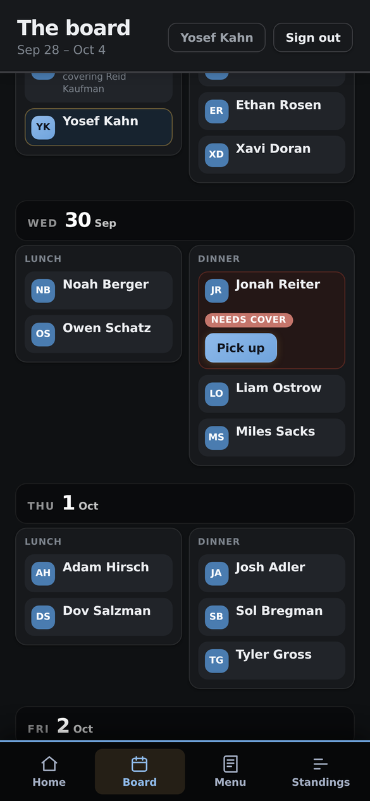
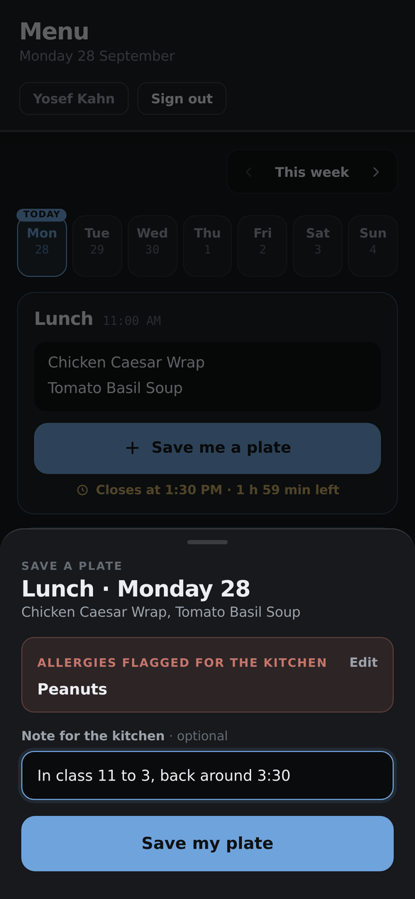
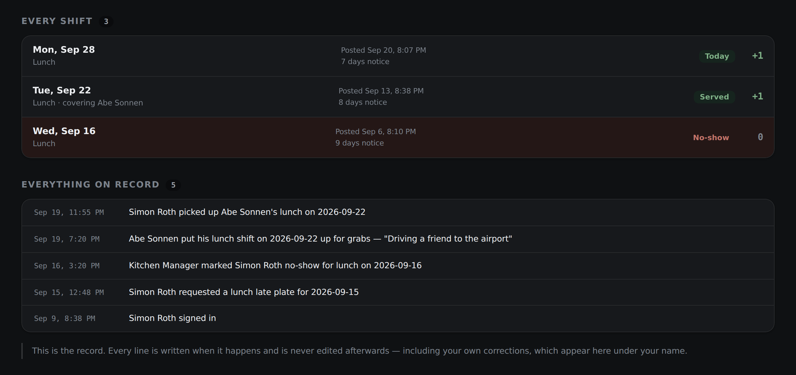
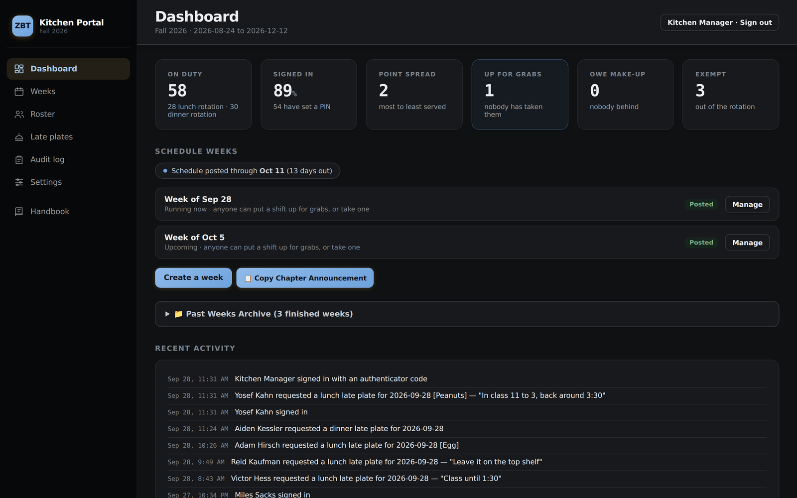
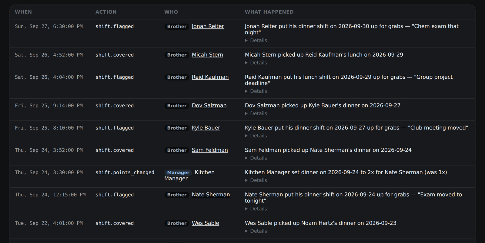

# Kitchen Portal

**Dining operations software for group-living houses: duty scheduling, late plates, menus, meal feedback and house polls, in one app for residents, chefs and the house's kitchen manager.**

In daily use since August 2026 by a fraternity chapter house of about 95 residents. It replaced a group-chat screenshot of the duty rotation, a sign-up sheet on the chefs' cart, and "I never knew I was on" arguments.

> This repository is a product overview: documentation and screenshots only. **The source code is private and proprietary.** I'm happy to give a live demo, or code access to reviewers on request: rsghorbani9@gmail.com
>
> Screenshots use a demo roster with fictional names. No real residents appear.

  
  
  

---

## The problem

A chapter house with a hired chef has three groups who all need the same information, and nothing that connects them:

- **Residents** need to know when they're on kitchen duty, trade shifts when life gets in the way, see the menu, and save a plate when class runs over the meal.
- **Chefs** need an accurate, allergy-safe list of plates to save, a simple way to publish the menu, and honest feedback on their food.
- **The kitchen manager**, a student volunteer who changes every year, has to run a fair duty rotation for dozens of people and settle disputes about who was on.

Kitchen Portal gives each group its own interface, built for the device it's actually used on, and backs them all with one record.

---

## Features by interface

### Residents (phone app)

**Home**
- Next shift at a glance, with who you're on with, and one-tap **Add to calendar**
- An auto-updating personal **calendar feed** of every assigned shift
- Points, standing in the house, and upcoming shifts
- **Standing availability:** block the days you can never do, and the draw respects them
- Open seats going spare, which anyone can take for the point

**Shifts and cover**
- **Put up for grabs** with a reason the house can see. The shift stays yours until someone takes it
- Offer **2× or 3×** from points you've already earned, paid only if somebody actually covers it
- **"I can't make it"** with clear, upfront consequences based on how much notice you give
- **"I'll be there"** confirmation, recorded while dropping is still free
- Coverers can hand a shift on under the same rules
- **The Board:** the whole week's lunch and dinner crews, open shifts and one-tap pickup

**Menu and late plates**
- The week's menu, day by day, viewable anywhere in seconds
- **Save me a plate** before the cutoff, with a live countdown
- Allergies and dietary needs attached to every request automatically
- An optional note for the kitchen ("in class until 3:30")
- **Recurring late plates** for a standing weekly schedule

**Feedback and the house conversation**
- **Up/down votes on every meal**, both before it's served ("sound good?") and after ("how was it?")
- **Meal requests:** ask for a dish and upvote others. Similar existing requests appear as you type, so duplicates don't pile up
- Comments and conversations with the kitchen, which the chefs can reply to
- Chef announcements, posted straight to the house
- Feedback is **anonymous to the kitchen**. Names are visible only to the manager

**Polls, standings and profile**
- House polls in five formats, with an unskippable popup for live polls and the option to change an answer
- **Standings:** every resident's points and rank
- Self-managed profile: room, Slack ID and allergies
- Six-digit PIN sign-in, PIN change, and "sign out everywhere"
- A read-only weekly menu for out-of-house seniors, behind a shared password

### Chefs (kitchen kiosk)

**Late plates**
- A live queue for lunch and dinner, with counts on each tab
- **Mandatory allergy acknowledgement:** allergies flagged in red on every plate
- **Ready** and **Can't do it** on each request
- A cutoff banner with a live countdown, so plating starts only when the list is final
- A **Taking requests** switch and cutoff time adjustments, in the chefs' own hands

**Menu**
- A week-by-week menu editor that publishes to every resident instantly
- Menu pairings, and scheduled meal requests shown alongside each day

**Feedback**
- **Meal ratings:** before- and after-serving scores for recent meals, with no names attached
- **Messages:** read the house's comments and reply, signed as the chef who answered
- **Requests:** triage what the house is asking for. Schedule it, mark it already made, save it for later, pass, merge duplicates, or dismiss it
- **Our ideas:** the kitchen's own idea bank, with when each dish was last made and when it's planned next. Schedule meals ahead with an assistive planner
- **Post to the house:** announcements written and published by the chefs themselves

**Device**
- Securely **paired** tablet or kitchen laptop, with no passwords on the kitchen counter and pairing status on screen

### Kitchen manager (desktop)

**Dashboard**
- Live tiles: residents on duty, sign-up rate, point spread, shifts up for grabs, make-ups owed, exemptions
- How far ahead the schedule is posted, current and upcoming weeks, and an archive
- One-click **chapter announcement** text
- Recent activity feed, and a running count of points the house has "minted"

**Weeks**
- **Draw** a week with a fair, reproducible scheduler: make-up debt first, then fewest points, then longest since served, then a seeded random draw
- A configurable limit on weeks in a row, so a resident who is far behind catches up at a sustainable pace
- A per-week overview with a **"Needs you"** list
- Attendance and no-shows, raising offers on open seats, and bounties

**Roster**
- An **import wizard** that takes the chapter export, a spreadsheet, pasted cells or a typed list, and shows every add, update and removal for approval first
- Bulk actions: rotations, exemptions with reasons, setup codes, removals
- **Points operations:** add, subtract, set or rebase for a selection or a whole crew, with a preview and a reason on every record
- One-time **setup codes** for claiming accounts
- A **record for each resident:** every shift, late drops, releases, waivers and the full audit trail
- **View as resident** to see exactly what the house sees

**Late plates and the kiosk**
- Pair, rename and revoke kitchen devices
- Default cutoffs and meal settings

**Feedback**
- Meal scores with authors, starred requests, hiding comments, and a **weekly digest**

**Polls**
- Five formats: pick one, pick several, rank, rating scale and written answer
- Audiences (everyone, on duty, one crew, residents living in), closing times, and anonymous mode
- Results with names, a list of who hasn't answered, copy-to-Slack, and CSV export

**Audit log**
- An append-only log of every consequential action
- Filter by category, exact action, actor type, resident, record and date range, or search free text
- Every view is a shareable URL, with CSV export

**Settings and operations**
- School-year rollover that carries the roster, points and settings forward
- Draw pace, roster defaults, and the menu password for out-of-house seniors
- **Slack integration:** reminders, cover posts and nudges, a switch for each message, built-in limits that keep the channel quiet, and a bot that deletes its own posts once they're resolved
- An **in-app handbook**, so next year's manager can run it without the person who built it

### Dining-room TV

A companion display on the same hardware shows today's menu, kitchen duty, weather, announcements, a dinner-duty checklist and the next bus from the house's stop. It reads from Kitchen Portal through a read-only key that returns names and counts only, never dietary information.

---

## More screens

| The chefs' lunch queue on the kitchen kiosk | A resident's record: every shift, with notice given |
|---|---|
|  |  |

---

## Built for real use

- **A full-stack progressive web app** that residents install from the browser, with no app store needed
- **Self-hosted** on a Raspberry Pi in the house. Published through an outbound-only Cloudflare Tunnel, so nothing listens on the house network
- **Security designed for an attacker who knows the house:** one-time setup codes, scrypt-hashed PINs with escalating lockout, signed sessions that can be revoked instantly, a manager account with password plus authenticator (TOTP), paired kitchen devices, and strict browser security headers. Residents in the house who study security have tried to break in and haven't managed it.
- **The record is the product:** every consequential change appends to an audit log that's never edited or deleted, which settles "I never knew I was on" with a timestamped chain instead of memory
- **Points can't drift:** the scheduler and points logic are pure, heavily tested functions. Randomized tests check that every point in the house is accounted for
- **Nightly encrypted backups** (AES-256-GCM) to a USB drive, with integrity checks and a scripted restore drill
- **Safe deploys:** typecheck, 400+ tests, backup, build, health check, and automatic rollback if unhealthy

See [SECURITY-OVERVIEW.md](SECURITY-OVERVIEW.md) for more on the security design.

---

## Where it's going

Any house or organization that feeds its members on a schedule (fraternities and sororities, co-ops, cooperative and religious houses, camps) has the same three-sided problem. The next step is to take Kitchen Portal from one house to many: multi-house hosting, onboarding without the builder present, and conversations with the food-service companies that staff these kitchens.

---

## Rights

**Copyright © 2026 Roman Sidney Ghorbani. All rights reserved.**

Kitchen Portal, including its source code, design, interfaces, documentation and the screenshots in this repository, is proprietary. Making this overview public grants no license. No part of Kitchen Portal may be copied, reproduced, modified, distributed, hosted for others, or used to create derivative works without my prior written permission. See [LICENSE](LICENSE).

Licensing, partnership and demo inquiries: rsghorbani9@gmail.com · [LinkedIn](https://linkedin.com/in/romanghorbani)

The chapter's name and letters appear in screenshots only because that is where Kitchen Portal is deployed. They belong to their owners and don't imply endorsement.
