# Kitchen Portal

**Dining operations software for group-living houses.** Duty scheduling, cover, late plates, menus, meal feedback and house polls, in one system with a screen for each person who needs it: residents on their phones, chefs on a kitchen tablet, and the house's kitchen manager at a desk.

In daily use since August 2026 by a fraternity chapter house of about 95 residents. It replaced a group-chat screenshot of the duty rotation, a sign-up sheet on the chefs' cart, and "I never knew I was on" arguments.

> This repository is a product overview: documentation and screenshots only. **The source code is private and proprietary.** I'm happy to give a live demo, or code access to reviewers on request: rsghorbani9@gmail.com
>
> Every screenshot comes from a demo house with fictional names and a few weeks of made-up activity. No real residents appear.

  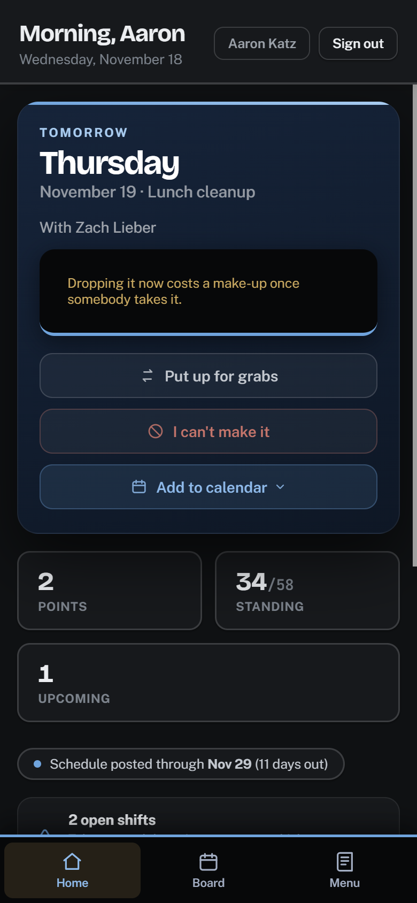
  
  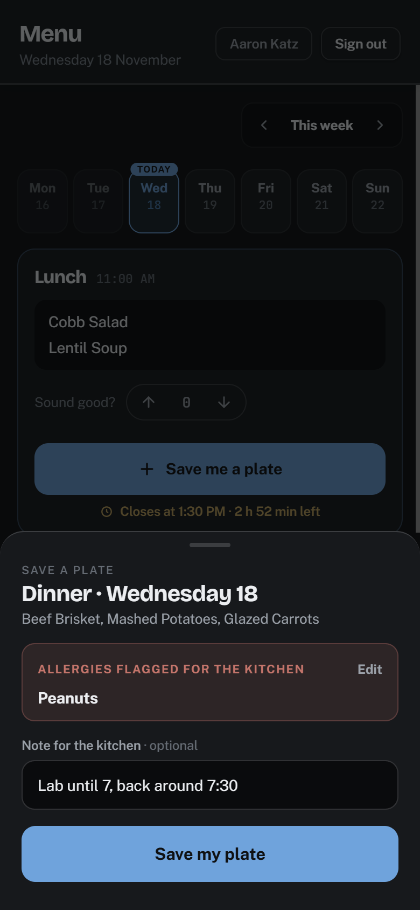

---

## One record, three screens

A house with a hired chef has three groups who all need the same information and nothing that connects them. Kitchen Portal gives each one an interface built for the device it's actually used on, all backed by a single record.

| Who | Where | What they do there |
|---|---|---|
| **Residents** | A phone app with three tabs | See their next shift, trade it, pick up open ones, vote on meals, talk to the kitchen, save a plate, answer polls |
| **Chefs** | A paired kitchen tablet | Work the late-plate queue, publish the menu, answer the house, decide what to cook next |
| **Kitchen manager** | A desktop console | Draw and post weeks, run the roster and points, read feedback with names, run polls, check the audit log |

The kitchen manager is a student volunteer who changes every year, so the system is built to be run by someone who has never met its author.

---

## Residents: the phone app

Installed from the browser, no app store. Three tabs: **Home**, **Board** and **Menu**.

### Home

- **Your next shift**, front and centre: the day, the meal, and who you're on with
- **Put up for grabs**, **I can't make it**, and **Add to calendar**, with the cost of each spelled out before you tap ("Dropping it now costs a make-up once somebody takes it")
- Points, standing in the house, upcoming shifts, and how far ahead the schedule is posted
- Open shifts anyone can take for the point, standing availability, and your history of served shifts

### Board

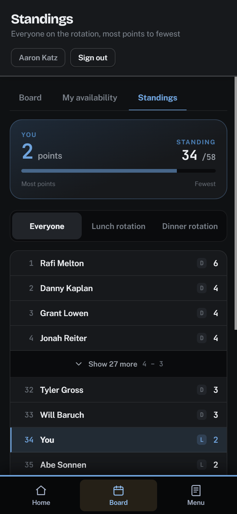

- **The board:** every posted week, day by day, with each lunch and dinner crew. Filter to your shifts, open shifts or everyone
- **Cover:** a shift up for grabs shows on the board with what it pays. Pick it up in one tap. Ask with 2× or 3× by adding points you've already earned, paid only if someone actually covers it
- **My availability:** block the days you can never do, like a weekly class, and the draw won't put you there
- **Standings:** every resident from most points to fewest, by rotation, with house totals and the points the house has "minted" this year

 

### Menu

- The week's menu, day by day, with last week and next week a tap away
- **Votes on every meal**, before it's served ("Sound good?") and after ("How was it?")
- **A comment thread on every meal** that the kitchen reads and answers, with votes on every message
- **Requests:** ask the kitchen for a dish and upvote what others asked for
- **Save me a plate** before the cutoff, with a live countdown, your allergies attached automatically, and an optional note. **Recurring plates** for a standing weekly schedule
- **No names.** The kitchen and the house see what you wrote, never who wrote it. Only the manager can see names

### Polls

A poll the manager puts live **pops up on any page until you answer it**. You can change your answer while it's open, and the results can be shown back to the house. Five formats: pick one, pick several, rank, rating scale, and written answer.

  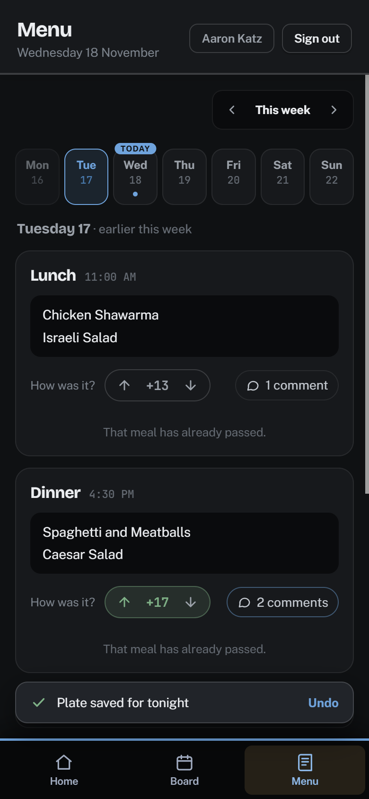
  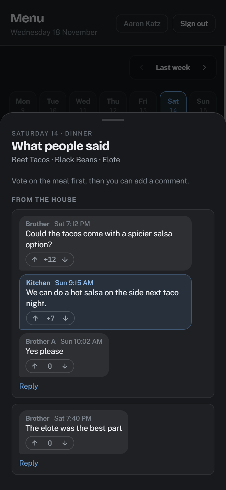
  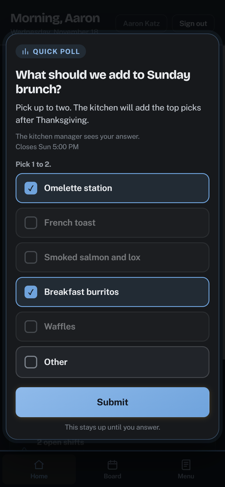

---

## Chefs: the kitchen tablet

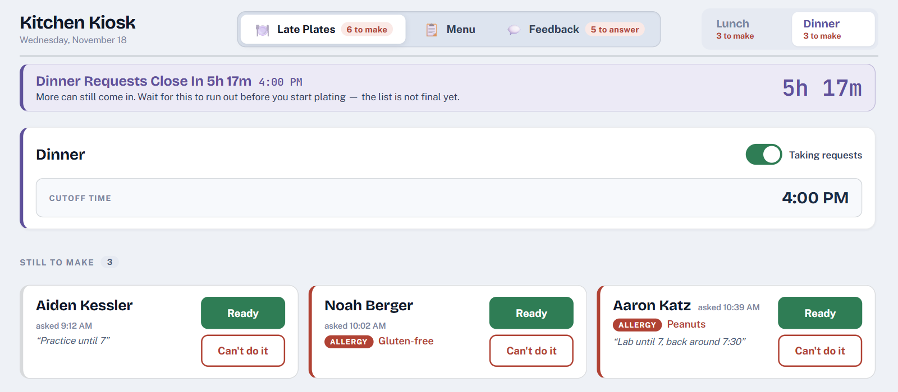

**Late Plates.** A live queue for each meal, with counts on each tab. Allergies are flagged in red on every plate. A cutoff banner counts down so plating starts only when the list is final. Each plate gets **Ready** or **Can't do it**, and the chefs control the **Taking requests** switch and cutoff times themselves.

**Menu.** A week-by-week editor. What the chefs type shows up on every phone and on the dining-room TV right away.

**Feedback.** Everything the house is saying, in one place, with no names:

- **Requests:** what the house is asking for, ranked by votes. **Schedule it** for a day and meal, **save for later**, mark it **already made**, **pass**, or remove a duplicate. Private kitchen notes sit next to public replies, and a request nobody acts on passes by itself
- **Messages:** meal comments waiting on a reply, answered by the kitchen while the resident who wrote it stays anonymous
- **Meal ratings**, **our ideas** (the kitchen's own idea bank), and **post to the house** for announcements

| Requests, ranked by the house | Messages waiting on the kitchen |
|---|---|
| 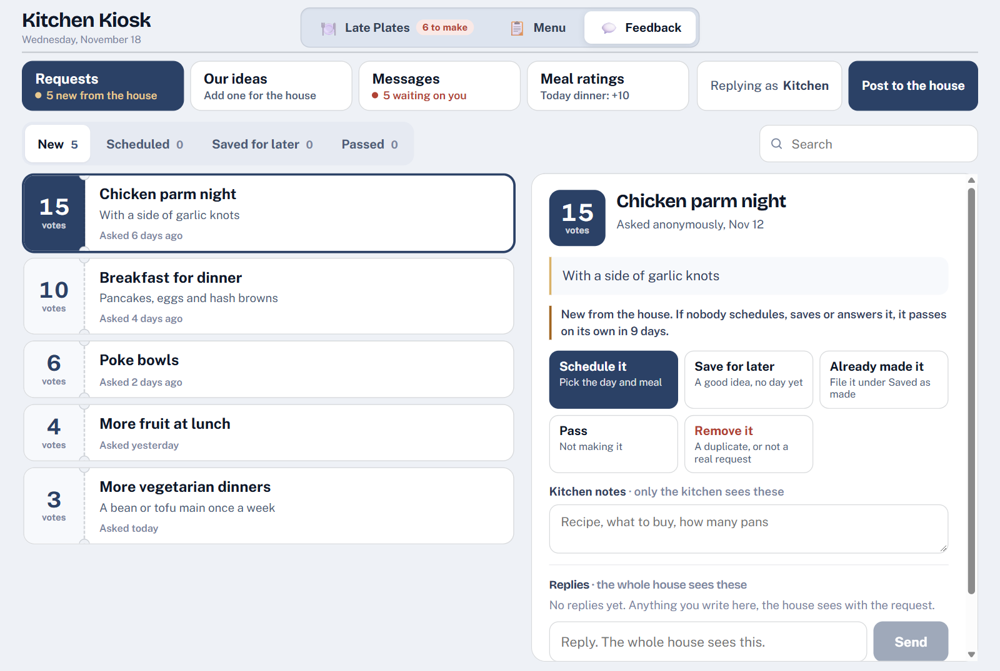 | 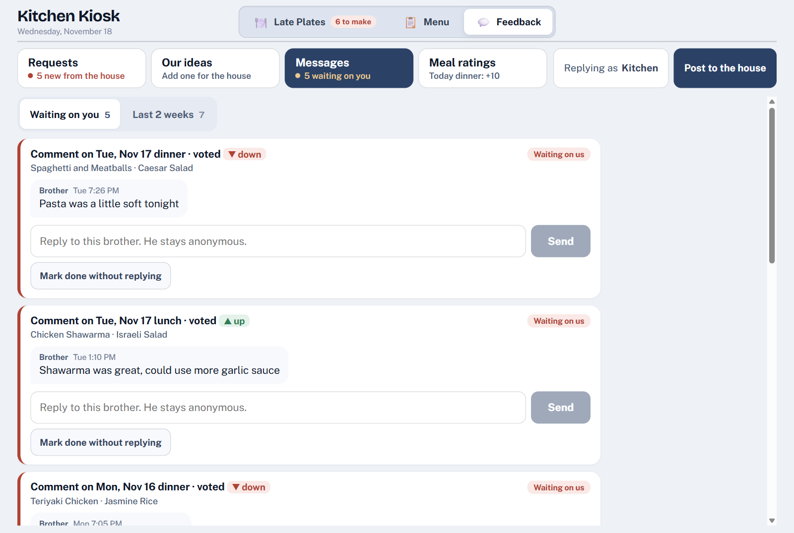 |

The tablet is **paired** with a short-lived code from the manager. There are no passwords on the kitchen counter, and each tablet can be revoked.

---

## Kitchen manager: the desktop console

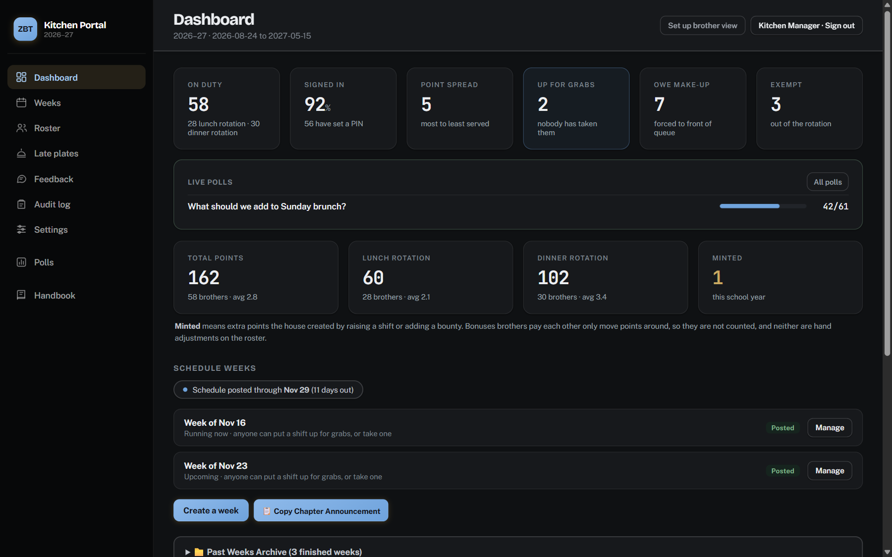

**Dashboard.** Live tiles for the house, live polls with their response progress, points by rotation, how far ahead the schedule is posted, and a one-click chapter announcement.

**Weeks.** Draw a week with a fair, reproducible scheduler, then post it. Each week has a **Needs you** list, and any shift can be reassigned, marked a no-show or posted for cover from the grid. A week that has started can't be deleted, because what the house was told is the record.

**Roster and records.** An import wizard that takes the chapter's export, a spreadsheet, pasted cells or a typed list, and shows every add, update and removal for approval first. Bulk rotations, exemptions, setup codes and points operations, each with a reason on every affected record. And **a record for every resident:** every shift with the notice they were given, and everything that ever happened to them.

| A posted week, and what needs attention | One resident's record |
|---|---|
| 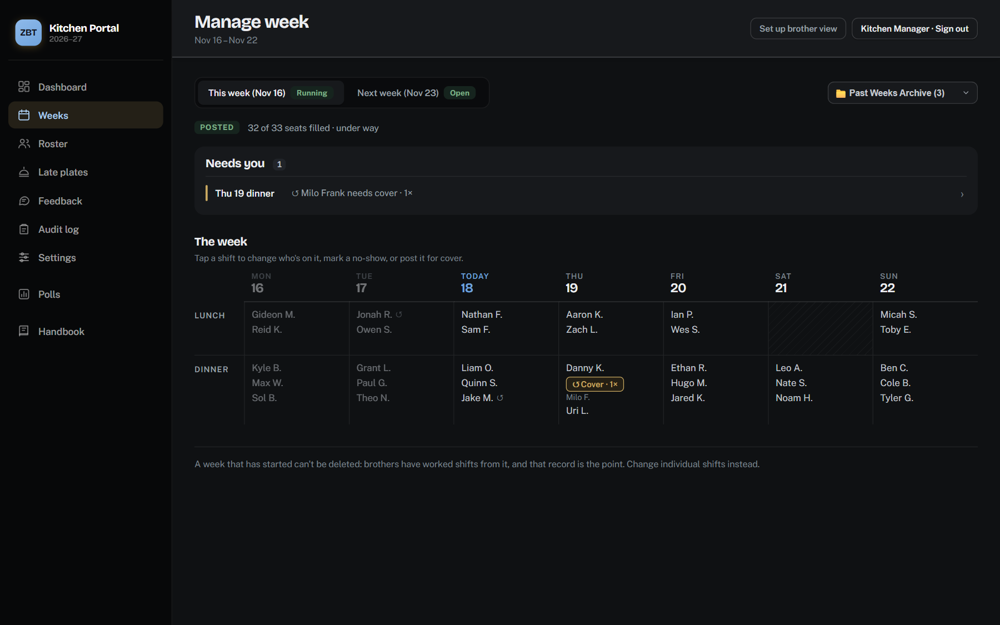 | 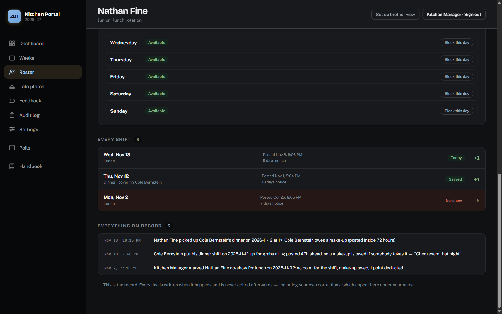 |

**Feedback, with names.** The week at a glance, conversations waiting on the kitchen, meal scores, requests and polls. Only the manager sees who wrote what. **Reveal name** shows one message's author to the house, and **Hide** takes a message off every screen. Both are logged and can be undone.

**Polls.** Five formats, a chosen audience, closing times and an anonymous mode. Live results with names, who still hasn't answered, a timing breakdown, and CSV export.

| This week's feedback | A live poll's results |
|---|---|
| 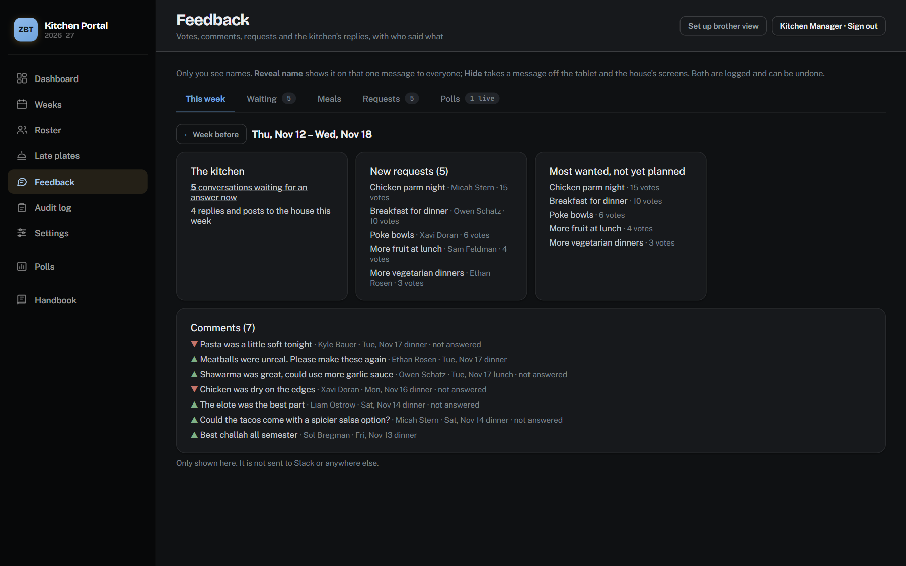 | 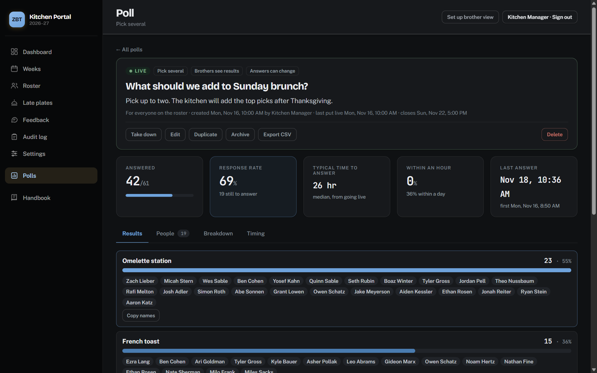 |

**Audit log.** Every consequential action, append-only: sign-ins, shifts, cover, points, plates, feedback and manager changes. Filter by category, action, who acted, resident, record and date range, or search free text. Every view is a link and exports to CSV.

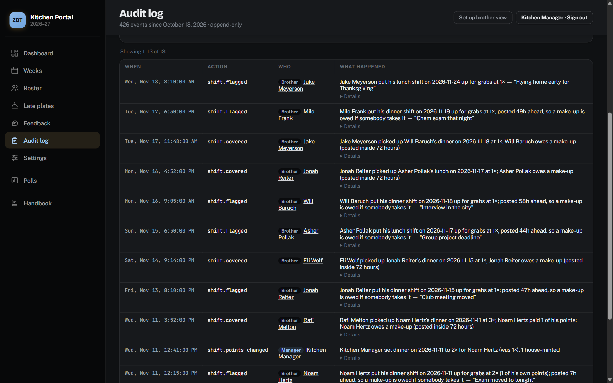

**Settings and the handbook.** School-year rollover that carries the roster, points and settings forward. Draw pace, roster defaults, Slack reminders and nudges with a switch for each message, and an **in-app handbook** so next year's manager can run it alone.

### Dining-room TV

A companion display on the same hardware shows today's menu, kitchen duty, weather, announcements, a dinner-duty checklist and the next bus from the house's stop. It reads from Kitchen Portal through a read-only key that returns names and counts only, never dietary information.

---

## The house rules, encoded

- **Who gets drawn.** Make-up debt first, then fewest points, then longest since last served, then a random draw seeded by the week, so any week can be reproduced exactly. Standing conflicts and exemptions are respected, with one shift per resident per week except make-ups.
- **Up for grabs isn't dropping out.** A shift up for grabs stays yours until somebody takes it, and only whoever serves earns the point. A bonus you offer comes out of points you've earned, is paid only if someone covers, and can never be promised twice. Cover moves points between residents. It never creates them.
- **"I can't make it" depends on notice.** With 72 hours' notice you come off the shift and owe a make-up. With less, it stays yours and the manager is flagged.
- **No-shows** never earn the point and, by default, owe a make-up and lose a point.
- **Minted points are counted.** Anything the house adds, such as a raised shift or a bounty on an open seat, is recorded apart from what residents funded, and the year's total is public.
- **Points can't drift.** Randomized tests replay posts, raises, pickups and corrections, and check that every point in the house is accounted for.
- **Feedback is open but nameless,** and **polls can't be skipped.**
- **Posted weeks are never regenerated.** What the house was told is the record.

---

## Built for real use

- **A full-stack progressive web app** that residents install from the browser
- **Self-hosted** on a Raspberry Pi in the house, published through an outbound-only Cloudflare Tunnel, so nothing listens on the house network
- **Security designed for an attacker who knows the house:** one-time setup codes, scrypt-hashed PINs with escalating lockout, signed sessions that can be revoked instantly, a manager account with a password and an authenticator code (TOTP), paired kitchen devices, and strict browser security headers. Residents who study security have tried to break in and haven't managed it.
- **The record is the product:** every consequential change appends to an audit log that is never edited or deleted, so "I never knew I was on" is answered with a timestamped chain instead of memory
- **Nightly encrypted backups** (AES-256-GCM) to a USB drive, with integrity checks and a scripted restore drill
- **Safe deploys:** typecheck, nearly 400 tests, backup, build, health check, and automatic rollback if unhealthy

See [SECURITY-OVERVIEW.md](SECURITY-OVERVIEW.md) for more on the security design.

---

## Where it's going

Any house or organization that feeds its members on a schedule (fraternities and sororities, co-ops, religious houses, camps) has the same three-sided problem. The next step is to take Kitchen Portal from one house to many: multi-house hosting, onboarding without the builder present, and conversations with the food-service companies that staff these kitchens.

---

## Rights

**Copyright © 2026 Roman Sidney Ghorbani. All rights reserved.**

Kitchen Portal, including its source code, design, interfaces, documentation and the screenshots in this repository, is proprietary. Making this overview public grants no license. No part of Kitchen Portal may be copied, reproduced, modified, distributed, hosted for others, or used to create derivative works without my prior written permission. See [LICENSE](LICENSE).

Licensing, partnership and demo inquiries: rsghorbani9@gmail.com · [LinkedIn](https://linkedin.com/in/romanghorbani)

The chapter's name and letters appear in screenshots only because that is where Kitchen Portal is deployed. They belong to their owners and don't imply endorsement.
